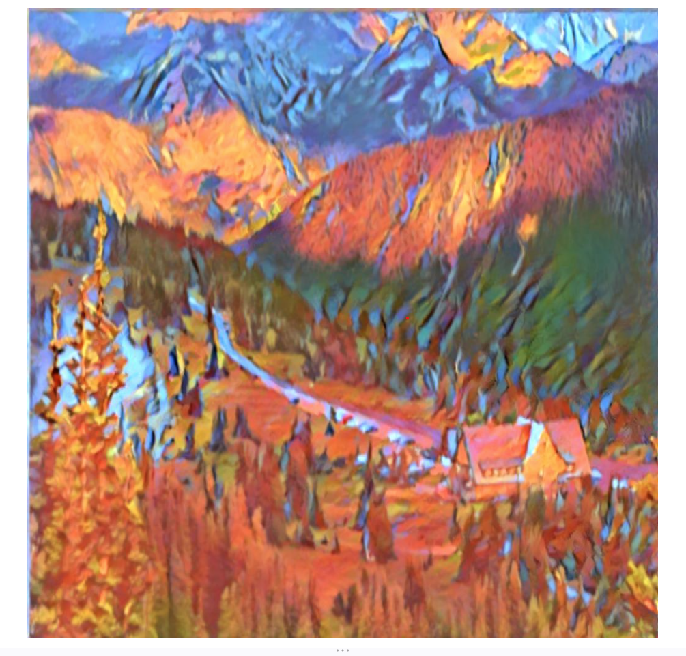
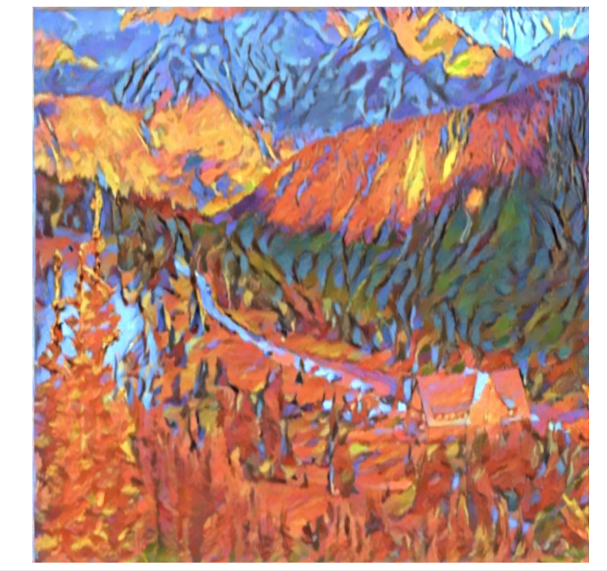
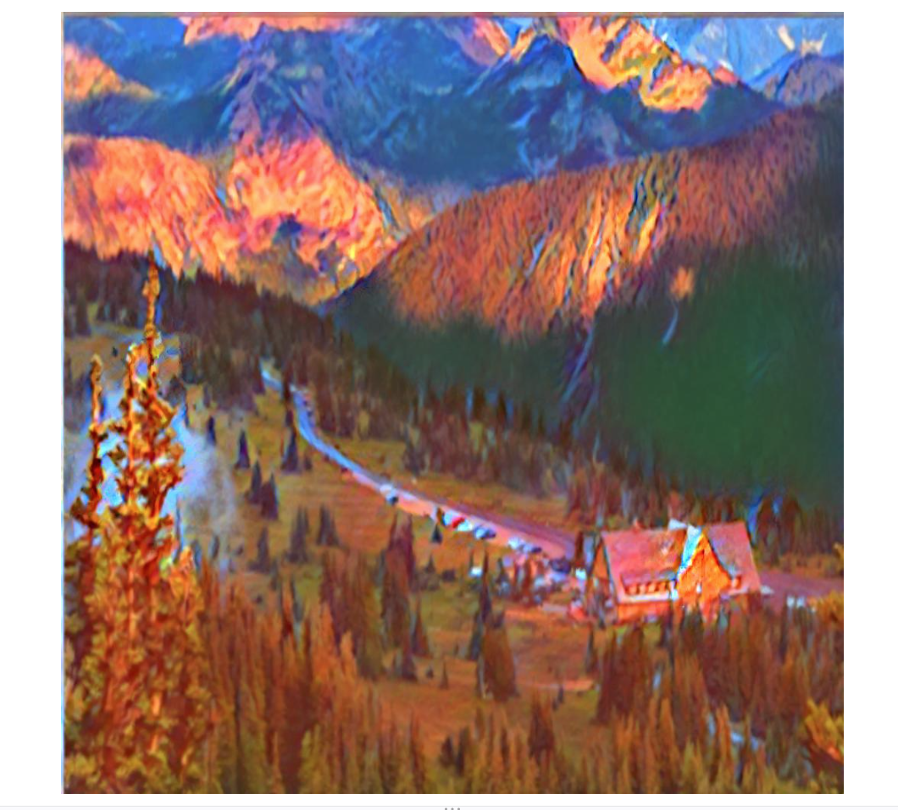

## 上传大小超出限制，所以只能在github仓库中提交
# 赛博画师
## 1. 模型预训练与微调
1.  - 预训练:在大规模数据集上训练一个模型，让它学会通用的视觉特征如边缘、纹理、风格等
    - 微调：将预训练好的模型针对小数据集和具体任务再训练，用较小的学习率继续训练几轮，把通用特征调整成任务专用特征
    - 好处：
        - 数据需求少：小数据集就能训练出好模型
        - 训练快：不用从随机权重开始，几十个 epoch 就能收敛
        - 精度高：预训练模型多样性高，泛化能力强
        - 省算力：预训练只做一次，微调成本低
2.  - 冻结参数：通用特征是参数是通用的的，在微调时，把模型前面的卷积层设param.requires_grad=False，让它们在反向传播时不更新。只训练最后的全连接层。作用：
冻结后参数量大幅减少，训练更快，小数据集过拟合风险更低。
    - 超参数设置：
        - 学习率：0.001~0.0001，比从头训练小，避免破坏预训练权重
        - Batch size：32，防爆显存
        - Epochs：10~30吗，微调不需要太多轮就能收敛
        - 优化器：Adam或SGD+Momentum，Adam更快，SGD泛化更好
        - Dropout：0.3~0.5，防过拟合
3.  - 风格迁移的核心是把一张图片的内容和另一张图的风格组合，而预训练模型的浅层网络提取的是边缘、纹理、颜色等的风格，深层网络提取的是物体结构、语义等的内容，能直接用于风格迁移的训练
## 2.
## 3. 代码细节
1. 有影响,但可放缩风格图或用Gram矩阵处理风格图
2. 内容损失：$L_{content} = \sum (F_{gen} - F_{content})^2$，让生成图的深层特征和内容图相似

   风格损失：$L_{style} = \sum (G_{gen} - G_{style})^2$，让生成图的浅层特征和风格图相似

   全变分损失：$L_{TV} = \sum |x_{i+1,j} - x_{i,j}| + |x_{i,j+1} - x_{i,j}|$，抑制相邻像素间色差过大

   三者加权求和得总损失
3. - Gram矩阵：把特征图展平后，计算通道之间内积的矩阵。作用：判断风格图的风格
   - 如果通道i和通道j在很多位置同时激活，内积就大，说明它们出现的很同步，风格图就拥有这种特征i，j同步的风格
4. - 风格可以出现在任何位置，位置信息是干扰，Gram忽视位置特征，又能让风格图能与内容图进行运算。
5. - 计算需要的是内容图和风格图在VGG里的特征，通过他们来改变生成图的特征。若不分离：则会导致：内容图和风格图特征改变，计算浪费，梯度方向错误
6. - 不是
    - model.eval():停止Dropout、BatchNorm等向前传播过程中的行为
    - 冻结参数：阻止参数更新，在反向传播的过程中发挥作用 
7.  - 内容层：深层
    - 风格层：浅层到中层的多个层，多层组合能捕捉多尺度的风格
8.  - L-BFGS：利用梯度^2进行反向传播，收敛速度快，占用内存大
    - 风格迁移参数量就是图片像素数，参数少，不会占用过多内存，训练速度快
9.  1. 加载内容图、风格图，预处理成张量
    2. 加载预训练 VGG，设 eval()，冻结参数
    3. 提取内容图的目标特征（detach）
    4. 提取风格图的目标 Gram 矩阵（detach）
    5. 初始化生成图为内容图的副本，requires_grad_(True)
    6. 选择优化器（L-BFGS 或 Adam）
    7. 循环：
        
        a. 前向：生成图过 VGG，取内容层和风格层特征
        
        b. 算内容损失、风格损失、TV 损失，加权求和
        
        c. 反向：loss.backward()
        
        d. 更新：optimizer.step()
        
        e. 可选：裁剪像素值到 [0,1]
    8. 输出生成图，反归一化，保存
10. - 前向传播：
        - 生成图→VGG→拿到指定层的特征图。
        - 内容层特征→算内容损失。
        - 风格层特征→算Gram矩阵→算风格损失。
        - 生成图本身→算TV损失。
        - 损失加权求和→总损失。
    - 反向传播：
        - loss.backward() 从总损失出发，一路回传到生成图的像素。
        - 生成图的.grad记录每个像素梯度下降方向。
11. - 超参数：content_weight内容损失权重，style_weight风格损失权重,tv_weightTV全变分损失权重，学习率epochs，内容层，风格层
    - 权重设置：风格权重大于内容权重，否则风格迁移效果不明显，tv权重最小，只用来平滑，太大会让图片模糊。
12. - 不是
        - 不同权重设置之间无法比较
        - 同一权重下也要以人眼观察舒适为准
    ***
    -   - 初始设置为content_weight=1,style_weight=1e6,tv_weight=1e-2,lr=1,epochs=30
        - 发现拟合效果不佳，epochs=30→50,图片模糊，tv_weight=1e-2→1e-6
        - 依旧未出现loss最低点，lr=1→5
        - 第二轮后loss变为nan，lr=5→1
        - 将style_weight=1e6设为1e7和1e5，得到不同风格权重的生成图
        - 与招新网站上的生成图对比，发现颜色明显偏向风格图，上次改变style_weight并无明显效果，添加color_loss,color_loss_weight=1e-3
        - 颜色确实有改善，但右上角山峰纹理几乎消失，下方树较为写实，style_weight=1e6→1e4
        - 经过weight调整、color_loss删除std部分，删除风格的conv1_1提取层，发现颜色与质感很难同时满足，最后引入直方图匹配进行颜色迁移，删除color_loss
        - 改善效果较好，获得成图
最终参数：content_weight=1,style_weight=1e6,tv_weight=1e-6,lr=1,epochs=50
13. 源码如下
```python
from PIL import Image
from torchvision import transforms
import torchvision.models as models
import torch
import torch.optim as optim
from torchvision.transforms.functional import to_pil_image


def set_seed(seed):
    torch.manual_seed(seed)
    torch.cuda.manual_seed(seed)
set_seed(0)

#数据准备
con_pth=r"D:\C++\屏幕截图 2026-10-11 112025.png"
sty_pth=r"D:\C++\屏幕截图 2026-10-11 112054.png"
transform=transforms.Compose([transforms.Resize((1024,1024)),transforms.ToTensor(),transforms.Normalize(mean=[0.485,0.456,0.406],std=[0.229,0.224,0.225])])
con_img=Image.open(con_pth).convert('RGB')
sty_img=Image.open(sty_pth).convert('RGB')
con_ten=transform(con_img).unsqueeze(0)
sty_ten=transform(sty_img).unsqueeze(0)

#初始化生成图


#加载预训练模型
vgg=models.vgg19(weights=models.VGG19_Weights.DEFAULT).features
for param in vgg.parameters():
    param.requires_grad=False
vgg.eval()

device=torch.device("cuda")
vgg=vgg.to(device)
con_ten=con_ten.to(device)
sty_ten=sty_ten.to(device)
gen_ten=con_ten.clone().to(device).detach().requires_grad_(True)

#定义特征提取工具
def get_features(image, model):
    layers={'0':'conv1_1','5':'conv2_1','10':'conv3_1','19':'conv4_1'，'21':'conv4_2','28':'conv5_1'}
    features={}
    for name,layer in model._modules.items():
        image=layer(image)
        if name in layers:
            features[layers[name]]=image
    return features
with torch.no_grad():
    content_features=get_features(con_ten,vgg)
    style_features=get_features(sty_ten,vgg)


  
def gram_matrix(ten):
    _,C,H,W=ten.size()
    ten=ten.view(C,H*W)
    gram=torch.mm(ten,ten.t())
    gram=gram/(C*H*W)
    return gram 


#定义损失函数
style_layers=['conv1_1','conv2_1','conv3_1','conv4_1','conv5_1']
content_layer='conv4_2'
style_grams={layer:gram_matrix(style_features[layer]) for layer in style_layers}

def tvloss(ten):
    diff_w=torch.abs(ten[:,:,:,1:]-ten[:,:,:,:-1])
    diff_h=torch.abs(ten[:,:,1:,:]-ten[:,:,:-1,:])
    loss=torch.sum(diff_h)+torch.sum(diff_w)
    return loss

optimizer=optim.LBFGS([gen_ten], lr=1)

#def colorloss(gen,cintent):
    #gen_mean=gen.mean(dim=[2,3]):
    #content_mean=content.mean(dim=[2,3])
    #return torch.mean((gen_mean-content_mean)**2)


#训练循环


epochs=50
vgg.eval()
losses=[]
lowest_loss=float('inf')
for epoch in range(epochs):
    def closure():
        optimizer.zero_grad()
        gen_features=get_features(gen_ten,vgg)
        content_loss=torch.mean((gen_features[content_layer]-content_features[content_layer])**2)
        style_loss=0
        for layer in style_layers:
            gen_gram=gram_matrix(gen_features[layer])
            style_loss+=torch.mean((gen_gram-style_grams[layer])**2)
        tv_loss=tvloss(gen_ten)
        #color_loss=colorloss(gen_ten,con_ten)
        total_loss=content_loss*1+style_loss*1e7+tv_loss*1e-6
        total_loss.backward() 
        return total_loss
    loss=optimizer.step(closure).item()
    print(f"epoch:{epoch+1}/{epochs},loss={loss:.4f}")
    if loss<lowest_loss:
        lowest_loss=loss
        def unnormalize(tensor):
            mean=torch.tensor([0.485,0.456,0.406]).view(3,1,1).to(tensor.device)
            std=torch.tensor([0.229,0.224,0.225]).view(3,1,1).to(tensor.device)
            return torch.clamp(tensor*std+mean,0,1)
        
        final_img=unnormalize(gen_ten.squeeze(0).detach().cpu()).clamp(0,1)
      
      
      
      
      
        from skimage.exposure import match_histograms
        import numpy as np

        gen_np=final_img.permute(1,2,0).numpy()
        con_np=np.array(con_img.resize((1024,1024)))/255
        matched=match_histograms(gen_np,con_np,channel_axis=-1)
        to_pil_image(torch.tensor(matched).permute(2,0,1)).save("cyber_painter_output.jpg")
        print("生成生成图'cyber_painter_output.jpg'")
```
## 4. 风格迁移的发展
1.  - 调小风格权重，并在生成成图后适当调节内容或全变分权重，使人眼观感较好
    -  - 设置风格权重style_loss_weight,style_loss_weight=？，应用：total_loss=content_loss* 1+style_loss* style_loss_weight+tv_loss*1e-6
        - style_loss_weight=1e6：

        - style_loss_weight=1e5

        - style_loss_weight=1e7


        - 调大style_loss_weight：优化器优化时更重视生成图与风格图的误差。使图片更偏向油画风格，但因为颜色属于浅层风格，所以颜色也会偏向油画。同时内容变形
        - 调小style_loss_weight：优化器优化时更重视生成图与内容图的误差。使图片内容更稳定，但风格偏写实
2.  - 将sty_...分为1，2，并用style_grams={layer:0.2* style_grams1[layer]+0.8* style_grams2[layer] for layer in style_layers}进行字典求和
    -   - 权重及结果如下：星空0.2，水墨0.8：画面过糊
 星空0.5，水墨0.5：
 星空0.8，水墨0.2：完全丢失水墨风

        - 效果较差，使用权重分层，星空笔触深层提取，水墨风浅层提取，调整整体权重:颜色发灰，水墨特征较弱

        - 效果依旧不好，将结尾直方图颜色迁移标准由content变为水墨画，同时调大星空整体权重，调小水墨整体权重，得到成图：


